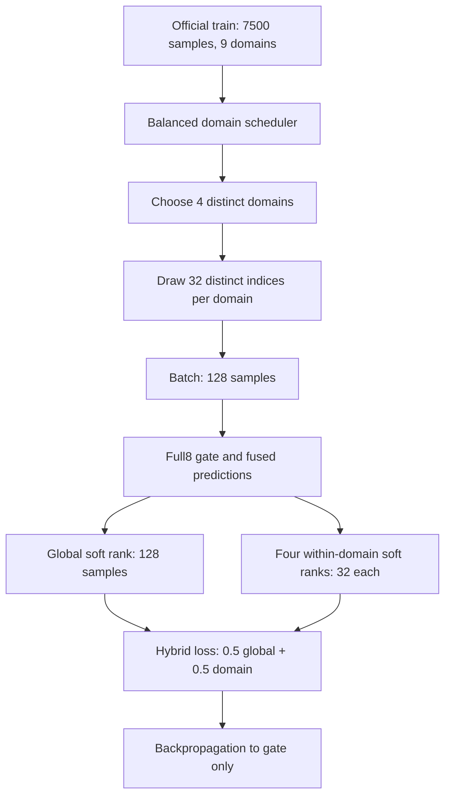
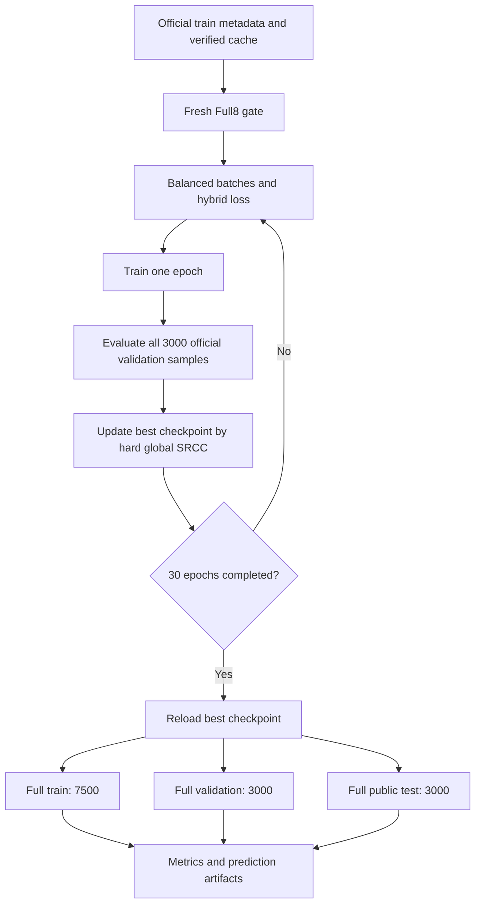

# MOE8-DSS — Experiment Overview

**Project:** XACLE Challenge 2027 / MOESCORE  
**Experiment:** Hybrid Global and Domain-wise Soft Spearman (MOE8-DSS; revised E4)  
**Model profile:** MOE8 (`full_8`)  
**Protocol:** Standard supervised gate training; no LOGO  
**Status:** Agreed experimental design; implementation and execution pending  
**Proposed branch:** `experiment/moe8-domain-wise-spearman`  
**Input artifacts:** `moescore_full8_artifacts`  
**Output artifacts:** `moescore_full8_dss_artifacts`  
**Platform:** Kaggle

## 1. Motivation and research objective

XACLE 2027 aims to predict human-rated semantic alignment between audio and text, including audio produced by previously unseen generation models. MOE8 combines eight frozen experts through a trainable gating network. The present experiment addresses ranking performance first, while preparing an objective that may later improve generator generalization.

The earlier gate-only LOGO-Lite experiment showed substantial variation in per-domain SRCC. Across the eight synthetic generators, pooled SRCC exceeded macro SRCC on all three splits:

| Split | Macro SRCC | Pooled SRCC | Pooled − macro |
| --- | ---: | ---: | ---: |
| Train holdout | 0.795654 | 0.853947 | 0.058293 |
| Validation | 0.581265 | 0.709597 | 0.128332 |
| Public test | 0.625879 | 0.700609 | 0.074729 |

After adding AudioCaps, nine-domain LOGO-Lite public-test macro SRCC was 0.608618, with worst-domain SRCC of 0.400001 (TangoFlux). These are user-provided research results, not the standard-training MOE8 baseline. The nine-domain pooled SRCC is not available from aggregate metrics alone.

The pooled–macro gap suggests that between-domain score distributions may contribute to global correlation. It does not establish shortcut learning: LOGO-Lite pooled predictions come from different gate checkpoints, and calibration and distribution differences may explain part of the gap.

The revised E4 experiment replaces the original MOE8 objective with an equally weighted combination of global and within-domain differentiable rank correlations. Balanced batches provide sufficient examples from each selected domain to calculate the within-domain loss.

### 1.1 Research questions

- **RQ1:** Can the proposed hybrid ranking objective improve global SRCC over standard-training MOE8?
- **RQ2:** Can it improve macro and worst-domain SRCC while maintaining competitive global SRCC?
- **RQ3 (future work):** Do any improvements transfer to unseen audio generators under an appropriate held-out-generator protocol?

RQ1 and RQ2 are evaluated in this experiment. RQ3 is not tested here. All nine development domains are seen during gate training; no strict unseen-generator generalization claim is permitted from this run.

## 2. Scope and fixed decisions

| Component | Required treatment |
| --- | --- |
| Gate training | Train exactly one fresh Full8 gate on the entire official training pool |
| Experts 1–8 | Frozen; reuse existing checkpoints indirectly through cached features and scores |
| Cache | Read-only reuse of `moescore_full8_artifacts`; no expert extraction |
| Gate architecture / feature order | Unchanged from compatible Full8 baseline |
| Gate initialization | Fresh random initialization with seed 2027; no baseline checkpoint warm start |
| Original loss | Remove all Clipped MSE, Contrastive and Diversity terms from the optimized objective |
| New loss | 0.5 Global Soft Spearman + 0.5 Domain-wise Soft Spearman |
| Batch sampling | Four distinct domains per batch, 32 examples per domain, total batch size 128 |
| Training duration | 30 epochs, 59 optimizer updates per epoch, 1,770 updates planned |
| Model selection | Highest finite global hard SRCC on full official validation; earliest epoch wins a tie |
| Final evaluation | One selected checkpoint; complete train, validation and labeled public test |
| Analysis | Global and per-domain metrics, sample-level predictions, expert scores, gate weights |
| Baseline comparison | Use existing compatible standard-training MOE8 results/predictions only; no baseline rerun |
| Out of scope | LOGO, expert fine-tuning, new experts, feature extraction, GroupDRO, E1–E3 ablations, hyperparameter search, external ensemble, test-driven tuning |

## 3. Dataset and integrity requirements

The XACLE 2027 development dataset contains human-averaged semantic alignment scores on a raw 0–10 scale. Use the pair-level averaged labels, not individual listener rows as separate training samples.

| Official split | Expected count | Role |
| --- | ---: | --- |
| Train | 7,500 | Only source of optimizer updates and balanced sampler indices |
| Validation | 3,000 | Evaluation after each epoch and best-checkpoint selection |
| Development / public test | 3,000 | Labeled final evaluation only |
| Total | 13,500 | Final prediction exports |

The public test here is the labeled development test, not the private/blind challenge test.

### 3.1 Expected domain distribution

| Model ID | Domain | Train | Validation | Public test |
| ---: | --- | ---: | ---: | ---: |
| 0 | audiocaps | 2,500 | 1,000 | 1,000 |
| 1 | audiogen | 750 | 250 | 250 |
| 2 | audioldm | 500 | 250 | 250 |
| 3 | audioldm2 | 500 | 250 | 250 |
| 4 | make-an-audio2 | 750 | 250 | 250 |
| 5 | stable_audio | 750 | 250 | 250 |
| 6 | tango | 500 | 250 | 250 |
| 7 | tango2 | 500 | 250 | 250 |
| 8 | tangoflux | 750 | 250 | 250 |
| | Total | 7,500 | 3,000 | 3,000 |

AudioCaps is the real-audio/control domain, but it is a normal sampling and loss group for this experiment. Do not exclude it or any other domain. These counts are expected from prior experiments and must be checked against the actual input files.

### 3.2 Metadata and cache alignment

Use official pair-level metadata (`train_average.csv`, `validation_average.csv`, `test_average.csv`, or the verified equivalent in the Kaggle packaging). The previously used Kaggle dataset is `qnv8071/xacle-2027-data`; the cache dataset is `qnv8071/moescore-full8-artifacts`. Discover mounted paths or allow explicit overrides. Do not assume filenames or CSV column capitalization: the organizer documentation and Kaggle packaging may differ (e.g. `model_id` / `model_ID`, `wave_file_name` / `wav_file_name`, `average_semantic_alignement_score` / `average_score`). Normalize to a documented internal schema only after validating the actual source columns.

Join official metadata and cached rows by stable split-qualified sample identity (e.g. `train:<wav_file_name>`, `validation:<wav_file_name>`, `test:<wav_file_name>`). Never join using row position alone. Preserve the original cache split identity even if the exported evaluation name is `public_test`.

Preflight must verify:

- Expected split counts, unique sample IDs, complete one-to-one cache coverage, stable ID-to-name mapping, no unrecognized/missing domain IDs, and correct audio/text pairing where available.
- Exactly eight ordered expert outputs, 33,032 gate input dimensions, finite features and scores, and compatible target/score transforms. Record cache manifest and source/config fingerprints.
- Finite raw labels in [0, 10]; cached train/validation labels, if present, agree with official metadata within a documented tolerance. Public-test cache labels may be absent; attach official labels by stable identity for final evaluation, not by position.
- Known cross-split audio overlap, if detectable through existing hashes or mounted audio. Preserve official splits; do not silently remove samples. Document overlap counts and any explicitly allowed research exception. The previous LOGO run reported overlap; verify rather than assuming identical counts.
- Inputs are read-only. If required data, labels, alignment, cache provenance or compatibility cannot be established, fail with an actionable diagnostic. Do not silently regenerate cache or run the baseline.

Only training labels and training indices may enter the optimization path. Validation labels are used for evaluation and checkpoint selection; public-test labels are evaluation-only. Preflight may verify test metadata integrity but must not compute test performance during training or expose test labels to the loss, sampler, optimizer, or selection logic.

## 4. Architecture and forward contract

Keep the compatible Full8 gate, expert order, preprocessing, score contracts and target transforms unchanged. The documented gate receives 33,032 cached features and produces eight softmax weights through a 512-unit hidden layer.

$$w_i = \operatorname{softmax}(G_\theta(z_i)),\qquad \hat y_i^{norm}=\sum_{e=1}^{8}w_{i,e}s_{i,e}.$$

Here $z_i$ is the cached feature vector, $s_{i,e}$ is the cached expert score, and $\theta$ contains only gate parameters. The eight scores follow the existing Full8 score contract; similarity proxies must not be silently recalibrated into regression scores.

Use the existing normalized target contract (documented as $y^{norm}=(y^{raw}-5)/5$) and inverse transform for exports (documented as $\hat y^{raw}=5\hat y^{norm}+5$); verify the actual compatible code. The Soft Rank operates on normalized fused predictions, so the regularization strength has a fixed meaning across runs. The exact hard target ranks are unchanged by the positive affine target transform. Compute MSE on raw scores, not on normalized scores. Do not add a new output head, post-hoc calibrator, clipping policy, feature normalization or score transform.

`model_id` is used for sampling, within-domain loss and reporting only. It must not be concatenated to gate inputs or be required at model inference. Experts and cache are immutable. Gate weights remain nonnegative and sum to one; the convex fusion constraint remains in effect.

## 5. Hybrid Soft Spearman Loss

### 5.1 Differentiable rank correlation

For predictions $p$ and targets $y$ in a set of $n$ samples, define:

$$a=R_{soft}(p;\epsilon_r),\qquad b=R(y).$$

- $R_{soft}$ is a differentiable ascending rank operator, using L2 regularization with strength $\epsilon_r=0.1$. Use a verified implementation (e.g. `torchsort.soft_rank` with `regularization="l2"`), not hard sorting/`argsort` of predictions.
- $R(y)$ is the exact ascending rank of targets with average ranks for ties; no gradients through targets.
- Calculate Pearson correlation between the two rank vectors in float32 or higher, using a numerically stable denominator:

$$\rho_{soft}(y,p)=\frac{\langle a-\bar a,b-\bar b\rangle}{\max(\|a-\bar a\|_2,\delta)\max(\|b-\bar b\|_2,\delta)}.$$

$$\mathcal L_{SS}(y,p)=1-\rho_{soft}(y,p).$$

Use an explicit numerical epsilon (proposed $\delta=10^{-8}$; verify stable gradients for nearly constant predictions). Disable reduced-precision autocast for rank/correlation math. Do not detach predictions, convert them to NumPy, or use SciPy correlation in the differentiable prediction path. Hard target ranks can be computed with a tested non-differentiable routine.

### 5.2 Global component

For the full balanced batch $B$ of 128 samples:

$$\mathcal L_{global}=1-\rho_{soft}(y_B,\hat y_B).$$

This term encourages ranking across the full batch, including between-domain comparisons. It is a balanced-batch approximation to global ranking, not the exact full-dataset global SRCC.

### 5.3 Domain-wise component

Let $G_B$ denote the four domain IDs selected in a batch and $B_g$ the 32 samples from domain $g$.

$$\mathcal L_g=1-\rho_{soft}(y_{B_g},\hat y_{B_g}),\qquad \mathcal L_{domain}=\frac{1}{|G_B|}\sum_{g\in G_B}\mathcal L_g.$$

Each valid domain has equal weight. The loss rewards correct ordering inside a domain rather than merely ordering domain means.

### 5.4 Final objective (complete replacement)

$$\boxed{\mathcal L_{total}=0.5\mathcal L_{global}+0.5\mathcal L_{domain}}$$

| Component | Weight in E4 |
| --- | ---: |
| Global Soft Spearman | 0.5 |
| Domain-wise Soft Spearman | 0.5 |
| Clipped MSE | 0 (disabled) |
| Contrastive loss | 0 (disabled) |
| Diversity loss | 0 (disabled) |

Do not compute or backpropagate the original loss terms in the DSS optimization path. AdamW weight decay remains enabled as an optimizer setting, not an additional task loss. Preserve original implementations for other configurations; do not change baseline semantics.

### 5.5 Edge cases and logging

- Require finite inputs, consistent shapes and at least eight samples per domain for the ranking term. The sampler normally guarantees 32.
- A group with constant ground-truth ranks has no defined correlation; exclude it from the domain loss denominator and log its ID/reason. If all domain groups are invalid, or the global target ranks are constant, fail explicitly rather than silently training a different objective. Do not use zero-filled invalid group losses.
- Constant prediction ranks must produce a finite loss using the stabilized denominator; do not skip groups merely because predictions are constant. Test constant and near-constant gradients; fail clearly on nonfinite loss or gradient. The implementation must not silently substitute an unrelated loss if the rank backend fails.
- Log the global loss, domain loss, total loss, per-domain loss and valid/invalid group counts. Record gradient norm, gate entropy and effective learning rate. Verify that the scalar total matches the specified 0.5/0.5 mixture and that gradients reach the gate.

Illustrative training step (adapt to the repository's actual forward and batch APIs):

```python
pred_norm, gate_weights = gate_forward(features, expert_scores)
global_loss = soft_spearman(pred_norm, target_norm)
domain_loss = domain_wise_soft_spearman(pred_norm, target_norm, model_ids)
loss = 0.5 * global_loss + 0.5 * domain_loss
optimizer.zero_grad(set_to_none=True)
loss.backward()
optimizer.step()
```

Implementation reference: Blondel et al., *Fast Differentiable Sorting and Ranking*, ICML 2020, https://proceedings.mlr.press/v119/blondel20a.html. The hybrid objective is the proposed project-specific design, not an assertion that this exact combination has already been validated in the paper or on XACLE.

## 6. Domain-balanced Batch Sampler

Each batch contains four **distinct** domain IDs and 32 distinct sample indices per selected domain. All nine domains participate across the epoch. The sampler sees only official train indices and labels must not determine sample selection.



### 6.1 Epoch definition

$$S=\left\lceil\frac{7500}{128}\right\rceil=59.$$

| Quantity | Value |
| --- | ---: |
| Domains per batch | 4 |
| Samples per domain | 32 |
| Batch size | 128 |
| Batches / optimizer updates per epoch | 59 |
| Draws per epoch (including repeats) | 7,552 |
| Training epochs | 30 |
| Total optimizer updates | 1,770 |
| Total sample draws | 226,560 |

An epoch is a fixed draw budget, not a complete pass through every unique training sample. Smaller domains are oversampled relative to their dataset proportions; AudioCaps is undersampled relative to its original one-third share. This intentionally changes the training distribution. Final evaluation uses ordinary sequential loaders on all samples without balancing or replacement.

### 6.2 Deterministic implementation policy

Use a seeded domain schedule that achieves approximately equal domain exposure. A concrete proposed policy is to draw a shuffled permutation of the nine IDs per epoch, cycle through it, and consume successive blocks of four IDs for 59 batches. Each block is distinct because the cycle length is nine. This yields 236 domain slots per epoch: each domain appears 26 or 27 times. Rotate/reseed the domain order across epochs to avoid systematic favoritism.

Maintain a shuffled sample-index queue per domain. Draw without replacement until the queue is exhausted, then reshuffle/cycle across batches; prevent any sample from repeating inside the same batch, even across a queue boundary. Carry queue state across epochs (or implement an equivalent documented deterministic policy with comparable coverage), so a large domain is not systematically left out. Persist the sampler RNG, domain ordering and queue state for epoch-boundary resume.

Validate the domain count and group size before training; insufficient groups or fewer than 32 distinct available examples in a selected group are preflight failures for this fixed design. Shuffle final batch ordering if useful; preserve alignment of features, scores, targets, IDs and metadata.

Log domain appearances, sample draws, unique sample coverage and repeat counts per epoch and across the run. Avoid interpreting 7,552 draws as 7,552 distinct samples.

## 7. Training configuration

| Setting | Effective E4 value |
| --- | --- |
| Seed | 2027 |
| Device | CUDA on Kaggle; CPU for integration tests |
| Optimizer | AdamW |
| Learning rate | 1e-5 |
| Weight decay | 1e-4 |
| LR scheduler | None; fixed LR for this first experiment (proposed implementation default) |
| Maximum epochs | 30 |
| Early stopping patience | 30, or explicitly disabled to ensure all 30 epochs |
| Batch size | 128 |
| Steps per epoch | 59 |
| Global / domain loss weights | 0.5 / 0.5 |
| Soft rank regularization | L2 |
| Regularization strength | 0.1 |
| Minimum domain group size | 8 |
| Inference batch size | 64 (retain compatible baseline default, verify) |
| Selection metric | Global hard validation SRCC, maximize |
| Tie-break | Earliest epoch |

The fixed learning-rate policy is an explicit implementation default because a scheduler for the new pure-ranking objective has not been agreed. Do not silently inherit the original regression-loss-driven scheduler; if a different scheduler is desired, record it as a protocol revision before execution. Preserve compatible baseline gate architecture and other non-conflicting forward settings. No hyperparameter tuning or multi-seed sweep is in scope.

### 7.1 Configuration reference

The following is a semantic configuration contract, not a claim that the current repository accepts this schema. Adapt keys to existing configuration code, retaining the effective values and validating them in preflight.

```yaml
experiment: MOE8-DSS
model_profile: full_8
runtime:
  seed: 2027
  device: cuda:0
model:
  freeze_experts: true
  reuse_feature_store: true
  initialize_from_baseline_gate: false
training:
  optimizer: adamw
  learning_rate: 0.00001
  weight_decay: 0.0001
  scheduler: none
  batch_size: 128
  max_epochs: 30
  early_stop_patience: 30
sampling:
  type: domain_balanced
  domains_per_batch: 4
  samples_per_domain: 32
  steps_per_epoch: 59
loss:
  type: hybrid_soft_spearman
  global_weight: 0.5
  domain_wise_weight: 0.5
  min_samples_per_domain: 8
  soft_rank:
    regularization: l2
    regularization_strength: 0.1
    target_rank_method: average
checkpoint_selection:
  split: validation
  metric: srcc
  mode: max
  tie_break: earliest_epoch
evaluation:
  splits: [train, validation, public_test]
  inference_batch_size: 64
  metrics: [srcc, lcc, ktau, mse]
  per_generator: true
  export_predictions: true
  export_expert_scores: true
  export_gate_weights: true
  require_ground_truth: true
output_dir: /kaggle/working/moescore_full8_dss_artifacts
```

## 8. Standard training and checkpoint selection



1. Run preflight, resolve the matching cache and source configuration, and create a fresh gate and optimizer. Do not load baseline gate weights.
2. Train on balanced batches from official train for exactly 30 epochs, 59 updates each, unless a technical failure interrupts execution. No LOGO splitting, no held-out generator and no fold loops.
3. After each epoch, switch to evaluation mode and use `torch.no_grad()` or inference mode on every official validation sample exactly once. Compute **hard Spearman SRCC** with average ranks for ties on the full 3,000 predictions and labels, not a mean of batch SRCCs or a Soft Spearman loss. Validation uses neither balanced sampling nor gradient updates.
4. Update `best.pt` only on a strictly greater finite validation SRCC. Keep the earliest epoch for exact ties. Save `last.pt` with epoch, gate/optimizer/sampler/RNG state, best-so-far metadata and run identity. Use 1-based epochs in reports. An undefined validation SRCC is recorded as undefined and cannot win; if no finite epoch exists, fail model selection.
5. After training, verify the selected checkpoint and reload its gate parameters. Evaluate the same gate on all three complete official splits, in eval mode, using standard non-replacement loaders. No public-test inference during checkpoint selection.
6. Export predictions and metrics. Treat smoke outputs as separate, non-final artifacts. Resume only compatible DSS checkpoints, not baseline or LOGO checkpoints; validate configuration, source/cache identity and split fingerprints before resuming. No automatic resume from mismatched or partially written artifacts.

## 9. Evaluation and reporting

### 9.1 Global metrics (required)

Calculate once per full split using the best gate's sample-level predictions. Use exact Spearman rank correlation (SRCC), Pearson correlation (LCC), Kendall tau-b (KTAU) and mean squared error on the raw 0–10 scale (MSE). Undefined correlations remain null/unavailable with an explanation; never silently replace them with zero.

| Split | Samples | SRCC | LCC | KTAU | MSE |
| --- | ---: | --- | --- | --- | --- |
| Train | 7,500 | Pending | Pending | Pending | Pending |
| Validation | 3,000 | Pending | Pending | Pending | Pending |
| Public test | 3,000 | Pending | Pending | Pending | Pending |

### 9.2 Per-domain and aggregate metrics (required)

Group each split's already-exported predictions by model ID. Report all nine domains with counts, SRCC, LCC, KTAU and MSE. Also report macro and weighted SRCC, worst SRCC and population standard deviation of per-domain SRCC.

For a split, let $V$ be the set of domains with defined SRCC $r_g$, and $n_g$ their evaluated sample counts.

$$r_{macro}=\frac{1}{|V|}\sum_{g\in V}r_g,\qquad r_{weighted}=\frac{\sum_{g\in V}n_g r_g}{\sum_{g\in V}n_g}.$$

$$r_{worst}=\min_{g\in V}r_g,\qquad r_{std}=\sqrt{\frac{1}{|V|}\sum_{g\in V}(r_g-r_{macro})^2}.$$

Global (pooled) SRCC is the correlation on all samples of the split from the **same** gate. It is not the weighted mean of per-domain SRCC. Include macro LCC, KTAU and MSE as supplementary summaries; global MSE is the sample-weighted per-domain MSE for complete coverage. Report valid-domain count and sample coverage. Report synthetic-only (IDs 1–8) macro SRCC separately from nine-domain macro SRCC if useful for diagnosing AudioCaps. These are project-defined domain summaries, **not LOGO metrics**.

### 9.3 Diagnostics (required)

Pure ranking loss does not directly enforce calibration or diverse routing. Preserve the following diagnostics:

- Training history: global soft loss, domain-wise soft loss, hybrid loss, full-validation hard SRCC, LR, gradient norm, valid group counts, sampler exposure and best epoch.
- Raw target/prediction mean, std, min/max, bias, fixed-bin 0–10 histograms and scatter plots by split and domain. Report prediction/target std ratio when defined; do not treat distribution similarity as evidence of ranking quality.
- Gate weight mean/std per expert, mean normalized entropy $H(w)/\log(8)$, top-1 expert frequencies and average maximum weight, by split and domain. Diagnose possible expert concentration after removing Diversity Loss; concentration alone does not prove failure.
- Per-domain SRCC bar chart, global vs macro SRCC, and comparison to compatible saved standard-training baseline data if available.
- Optional offline within-domain prediction shuffling or score-envelope diagnostics can be derived from exported predictions without retraining; they are not required for completion and cannot be used to tune on public test.

### 9.4 Prediction export contract

Write one row per original sample with at least: stable `sample_id`, `source_split`, `wav_file_name`, `model_id`, `model_name`, `ground_truth_raw`, `prediction_raw`, normalized target/prediction where useful, eight ordered expert scores and eight ordered gate weights. Record expert order and score scale in metadata. Validate row counts, uniqueness, finite values and sum-to-one weights. All final artifacts must refer to the selected gate checkpoint SHA/hash.

## 10. Repository implementation plan

Repository: `vietquang8071/MOESCORE`. Proposed base branch: `feature/xacle2027-full8-m2d-clap`, or the exact compatible Full8 source commit identified from the cache manifest. Resolve and record the actual commit before branching; do not assume the latest branch head is compatible. Existing LOGO utilities may be reused for safe metadata joins, preflight or metric export, but do not route this run through the LOGO fold experiment.

Suggested layout (adapt to actual repo conventions; names are proposed, not existing files):

```text
MOESCORE/
├── loss/
│   └── domain_spearman.py
├── training/
│   ├── domain_balanced_sampler.py
│   └── dss_runner.py
├── configs/
│   └── moe_full8_dss.example.yaml
├── scripts/
│   └── train_moe8_dss.py
├── notebooks/
│   └── MOESCORE_Full8_DSS_Kaggle.ipynb
├── tests/
│   ├── test_domain_spearman.py
│   ├── test_domain_balanced_sampler.py
│   └── test_dss_integration.py
└── docs/DSS/
    ├── DSS-overview.md
    ├── implementation_report.md
    └── experiment_report.md
```

Implement `SoftSpearmanLoss`, `DomainWiseSoftSpearmanLoss`, `HybridSoftSpearmanLoss` and `DomainBalancedBatchSampler`. Reuse existing Full8 model/feature-store APIs rather than duplicating gate architecture. Add a thin metadata-aware training dataset or batch adapter; do not mutate historical cache format. Explicit experiment overrides must be separate from immutable baseline configuration and its identity/hash. Baseline and LOGO modes remain backward compatible.

The Kaggle notebook should be a thin orchestrator: pin/checkout source, discover inputs, verify dependencies (including differentiable rank backend), run preflight, optionally run a separate 1–2 epoch smoke test, then execute the full run and export artifacts. No manual edits between cells; support Save & Run All. Smoke and full output directories must be isolated. A missing rank dependency or incompatible backend is a blocker, not permission to fall back to MSE or nondifferentiable ranks. Record Python/PyTorch/CUDA/rank-backend versions; do not install unrelated model dependencies or load expert checkpoints unnecessarily.

## 11. Verification and acceptance tests

| Area | Required checks |
| --- | --- |
| Soft rank | Correct ascending orientation, perfect/reverse ranking, tie-aware exact target ranks, finite loss for constant/near-constant predictions, valid gradients and finite-difference sanity check on suitable nondegenerate inputs |
| Domain loss | Independent group ranks; arithmetic mean of valid domains; invalid group handling; equal weight for groups; changing one domain cannot change another domain's individual loss |
| Hybrid loss | Exact 0.5/0.5 combination; original loss terms never evaluated in DSS mode; gradient reaches trainable gate |
| Sampler | 128 rows, exactly 4 distinct domains × 32 unique indices; 59 batches per epoch; all nine groups represented; balanced exposure, correct boundaries, deterministic seed and resume |
| Data | Stable ID join survives reordered metadata; missing/duplicate/misaligned samples fail; test labels never enter training; all nine domains retained |
| Model | Fresh gate; frozen/unchanged cached outputs; correct feature and expert order; gate weights sum to one; model forward does not consume generator ID |
| Selection | Hard full-validation SRCC, strict max, earliest tie, undefined values handled, best checkpoint reloaded rather than last |
| Evaluation | Exactly 7,500/3,000/3,000 final rows; raw-scale MSE, exact SRCC/LCC/KTAU, correct domain aggregation, no public-test checkpoint decisions |
| Resume | Matching identity and exact epoch-boundary continuation; incompatible artifacts rejected; smoke cannot overwrite full run |
| Regression | Existing Full8 and LOGO paths remain unchanged and their applicable tests pass |

Run targeted unit tests and a CPU synthetic-cache integration test before the Kaggle smoke run. The GPU smoke checks dependency compatibility, memory, gradients, step counts, validation selection and export schema; it does not establish performance. A complete run requires all 30 epochs, 1,770 optimizer steps, a finite selected validation SRCC, all three labeled final exports, all required metrics and integrity reports. Record actual deviations rather than marking a partial run complete.

## 12. Output artifacts

```text
/kaggle/working/moescore_full8_dss_artifacts/
├── experiment_config.yaml
├── experiment_metadata.json
├── preflight_report.json
├── checkpoints/
│   ├── best.pt
│   └── last.pt
├── training_history.csv
├── sampler_history.csv
├── predictions/
│   ├── train.csv
│   ├── validation.csv
│   └── public_test.csv
├── metrics/
│   ├── global_metrics.json
│   ├── per_generator_metrics.csv
│   ├── aggregate_metrics.json
│   └── gate_diagnostics.csv
├── plots/
│   ├── training_loss.png
│   ├── validation_srcc.png
│   ├── per_generator_srcc.png
│   ├── score_distributions.png
│   └── expert_weights.png
└── report.md
```

Record source commit, effective configuration, input cache and metadata fingerprints, sample counts, rank backend, seed, hardware, runtime, actual steps, selected epoch and checkpoint identity. Save status (`COMPLETE`, `PARTIAL`, or `FAILED`) and clear failure reasons. Exact layout may be adapted if documented and outputs remain equivalent.

## 13. Comparison and interpretation

Compare against the **standard-training Full8 MOE8 baseline**, with all domains in training, the same official split membership and compatible metric definitions. Use existing saved baseline predictions/metrics only. Verify checkpoint provenance and sample alignment before calculating deltas. If unavailable, report baseline comparison as blocked; complete the new experiment independently. Do not use the LOGO-Lite macro SRCC of 0.608618 as a directly comparable standard-training baseline.

| Metric | Standard MOE8 baseline | MOE8-DSS | Delta |
| --- | --- | --- | --- |
| Global validation SRCC (selection metric) | Pending verification | Pending | Pending |
| Global public-test SRCC | Pending verification | Pending | Pending |
| Public-test macro SRCC (9 domains) | Pending verification | Pending | Pending |
| Public-test macro SRCC (8 synthetic domains) | Pending verification | Pending | Pending |
| Public-test worst SRCC | Pending verification | Pending | Pending |
| Public-test SRCC std | Pending verification | Pending | Pending |
| Public-test LCC / KTAU / MSE | Pending verification | Pending | Pending |

The main success signal is higher global validation SRCC and competitive global public-test SRCC, supported by improved per-domain/macro/worst SRCC and reported calibration/routing trade-offs. No numeric improvement is guaranteed. The experiment remains useful even if DSS underperforms.

Limitations:

- E4 simultaneously changes loss, sampling, batch size and training duration. Improvement or deterioration is attributable to the combined configuration, not uniquely to the hybrid loss. Controlled ablations are future work.
- Training budget is 1,770 updates, substantially smaller than a 50-epoch, batch-8 run over all 7,500 samples (approximately 46,900 updates if the last partial batch is retained). Report actual baseline steps if known. Undertraining is possible; inspect learning curves and best epoch without extending the agreed run automatically.
- Hard SRCC is invariant to strictly increasing transformations; the soft surrogate depends on its regularization scale. The new objective does not explicitly optimize calibration/MSE and removing Diversity Loss may alter expert usage.
- Equal-domain sampling changes the population weighting of the global loss. Four-domain mini-batch ranking is not the full validation ranking.
- A single fixed seed does not establish statistical robustness. Validation is used for model selection; public test has been inspected in earlier research and must not be used to tune E4 or subsequent variants.
- All nine development domains are seen in this experiment. Any unseen-generator claim requires a future held-out-generator evaluation with source-only selection and, for strict whole-model generalization, expert provenance/retraining that excludes the target generator.
- Follow XACLE rules: train only on training data, use validation/test for evaluation, no new training audio/text/labels, no external model-output ensemble, and verify organizer approval for existing external models/data. The current experiment introduces no new expert or dataset.

## 14. Implementation roadmap

| ID | Task | Deliverable |
| --- | --- | --- |
| DSS-01 | Freeze specification; establish compatible base commit and new branch | Overview and branch/provenance |
| DSS-02 | Implement global, domain-wise and hybrid Soft Spearman | Tested loss modules |
| DSS-03 | Implement balanced sampler and metadata adapter | Deterministic 4 × 32 batches |
| DSS-04 | Integrate standard Full8 gate trainer and evaluation | Dedicated runner, config and CLI; no LOGO |
| DSS-05 | Unit tests and CPU integration test | Test results and integrity assertions |
| DSS-06 | Kaggle notebook and isolated GPU smoke | Reproducible notebook and smoke report |
| DSS-07 | Run one gate for 30 epochs | Best/last checkpoints and history |
| DSS-08 | Reload best gate; evaluate all three splits | 13,500 predictions, metrics and plots |
| DSS-09 | Compare with existing standard MOE8 baseline | Implementation and experiment reports |

## 15. References and specification status

- Project discussion: revised E4 decisions (standard training, pure hybrid ranking loss, 30 epochs, 128 batch size, validation selection and three-split inference).
- `LOGO-lite-overview-v2.md`: previous gate-only research protocol, cache reuse and metric conventions; not the execution protocol of this experiment.
- `XACLE-development.md`: prior Full8 architecture, target contract, diagnostic concerns and rules summary.
- `Task-description.txt`, `Task-rules.txt`, `Data-2027-description.txt`: challenge objective, constraints and dataset description.
- Blondel et al., ICML 2020: differentiable sorting/ranking reference (linked in Section 5).

The agreed design is recorded here; no repository edits, dependency installation, GPU training or baseline verification have been performed while drafting this document. The scheduler policy, deterministic sampler details, numerical safeguards, file layout and test/diagnostic contracts are proposed implementation defaults and must be made explicit in the implementation report. The actual cache schema, source commit, dependency compatibility and saved standard-training baseline availability must be verified during implementation/preflight.
