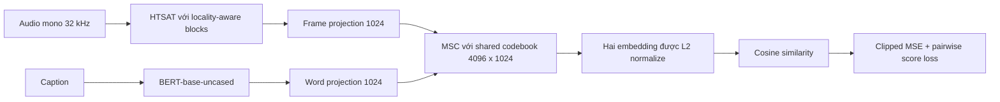

# Phương án reproduce finetune Expert 2 — MGA-CLAP

Ngày phân tích: 2026-10-29.

**Cập nhật triển khai:** Đã có source chính thức trong `MGA-CLAP/` và XACLE 2027 development dataset trong `../../data/XACLE_Challenge_2027_development_dataset/XACLE_Challenge_2027_development_dataset`. Code finetune cosine đã được thêm ở `Train_Expert2.py`, `expert2_model.py`, `expert2_data.py`, `expert2_loss.py` và `configs/expert2_finetune.yaml`; lệnh chạy nằm trong [Expert2_README.md](Expert2_README.md). Các phần dưới đây ghi lại giả định và phương án nghiên cứu ban đầu; mục §9 là thiết kế file trước khi triển khai, tên file thực tế theo cập nhật này.

## 1. Kết luận và phạm vi

**Đề xuất xây dựng một pipeline finetune Expert 2 độc lập: khởi tạo MGA-CLAP từ `weights/mga-clap.pt`, giữ HTSAT + BERT + modality-shared codebook, học điểm semantic alignment của XACLE bằng clipped MSE và loss chênh lệch điểm giữa các cặp mẫu.** Chọn checkpoint theo SRCC trên validation, xuất trọng số tương thích với Expert 2 rồi mới tích hợp vào MoE.

**Quyết định đã chốt: Expert 2 dự đoán bằng cosine similarity trực tiếp như code hiện có.** Nhánh finetune chính mở hai block cuối của mỗi encoder, các projection và codebook; chạy thêm đối chứng cosine với toàn bộ backbone được phép cập nhật để kiểm tra freeze policy. MLP trong Figure 1(c) chỉ còn là khác biệt cần ghi nhận khi diễn giải paper, không nằm trong phạm vi triển khai hay đối chứng của phương án này.

Những việc còn phải giải quyết để **chạy được** finetune:

1. Có dữ liệu XACLE average 7.500/3.000 cặp và môi trường PyTorch/torchaudio; workspace hiện mới có checkpoint MGA.
2. Tích hợp source MGA chính thức (`ASE`, HTSAT, BERT và dependencies), nạp `weights/mga-clap.pt['model']` với kiểm tra key/shape nghiêm ngặt.
3. Sửa đường dữ liệu của Expert 2 để dùng mono 32 kHz và cùng một tên key caption ở train/inference; hiện wrapper dùng `wavs` 16 kHz trong khi dataset đã tạo `mga_wavs`.
4. Huấn luyện Expert 2 bằng trainer riêng và loss nhận prediction `[B]`; script MoE hiện chỉ train gate, còn prediction `[B,1]` có thể làm pairwise loss broadcast sai.
5. Chốt và ghi lại freeze policy, lịch học và các giả định còn thiếu trong paper; chạy P0/P1/P2 rồi chọn checkpoint bằng SRCC validation.

Các mục 1–4 là công việc triển khai bắt buộc. Mục 5 đã có lựa chọn mặc định trong tài liệu nên không cần thêm quyết định về head trước khi bắt đầu; chỉ chưa thể bảo đảm khớp chính xác kết quả của tác giả.

Mục tiêu riêng của Expert 2 là kết quả ở **MOESCORE, Table 2, validation**:

| SRCC ↑ | LCC ↑ | KTAU ↑ | MSE ↓ |
|---:|---:|---:|---:|
| 0.6297 | 0.6562 | 0.4550 | 3.7208 |

SRCC 0.6680 là của MoE bốn expert trên validation; 0.6402 là của MoE trên blind test. Không dùng hai số này làm tiêu chuẩn cho Expert 2 độc lập.

Tài liệu này là phương án triển khai và thực nghiệm. Source, CSV và WAV đã được bổ sung sau lần phân tích đầu. Đã kiểm tra strict-load/forward/backward với MGA trên GPU và chạy test của trainer; chưa chạy một epoch finetune đầy đủ hay xác nhận đạt các metric trên. Python mặc định chưa có `torch`; môi trường `nlp` có PyTorch nhưng một số dependency âm thanh phải cài thêm.

## 2. Căn cứ đã kiểm tra

### 2.1. Hai paper trong thư mục

| Nguồn | Nội dung dùng để tái lập |
|---|---|
| [MOESCORE.pdf](MOESCORE.pdf), *MoEScore: Mixture-of-Experts-Based Text-Audio Relevance Score Prediction for Text-to-Audio System Evaluation*, arXiv:2601.06829v1 | §2.1: expert 2 là MGA-CLAP; các expert được finetune riêng rồi đóng băng khi train gate. Trang 2, Figure 1(c): hai lớp cuối, alignment module và MLP. §2.3: loss. Table 2: metric riêng Expert 2. |
| [Sun_NPU_Sun_NPU.pdf](Sun_NPU_Sun_NPU.pdf), *TASALIGN: An Objective Evaluation Method for Text-Audio Semantic Alignment Based on Mixture of Experts and Sequential Cross-Attention* | §2: 7.500/3.000 cặp train/validation, audio mono 16 kHz, nhãn 0–10. §3.2: các expert và gate. Trang 4, §4: Adam, batch 8, LR 1e-5, linear warm-up/decay, lựa chọn theo SRCC. |

**Paper thứ hai là báo cáo TASALIGN, không phải paper gốc MGA-CLAP năm 2024.** Hai tài liệu cùng mô tả hệ thống đánh giá XACLE. Để bổ sung phần ASE bị thiếu trong workspace, đã đối chiếu repository chính thức của MGA-CLAP được README dự án dẫn tới.

Đã xem trực tiếp ảnh Figure 1(c) và trang công thức, ngoài việc trích xuất text. Công thức contrastive trong PDF có trị tuyệt đối `|d_hat - d|`; bản trích xuất text có thể làm mất hai dấu này.

### 2.2. Mã nguồn và checkpoint

Đã đọc các file Python của repo, `config.yaml`, `README.md`, `Colab_Expert1.ipynb` và metadata của checkpoint MGA. Những điểm tham chiếu chính:

- [model/Basic_comp.py](model/Basic_comp.py): `MGA_audio_text_encoder` khoảng dòng 130, `Expert2` khoảng dòng 259.
- [model/MOE_model.py](model/MOE_model.py): tải checkpoint expert, đóng băng expert, train gating network.
- [data/dataset.py](data/dataset.py): đọc dữ liệu, resample và chuẩn hóa nhãn.
- [loss/loss_function.py](loss/loss_function.py): định nghĩa loss thực tế.
- [Train_MOE.py](Train_MOE.py), [Train_Expert1.py](Train_Expert1.py): hai vòng lặp train hiện có.
- [evaluate/evaluate.py](evaluate/evaluate.py): SRCC, Pearson LCC, Kendall tau-b và MSE.

HEAD local khi kiểm tra: `0fbd7ad8ed89da0a96e0f03d730dc3997c66fd6d`. Có file ngoài Git, bao gồm `Train_Expert1.py`, notebook và PDF, nên HEAD không đại diện đầy đủ cho snapshot đã phân tích.

Metadata checkpoint được đọc bằng `zipfile`/`pickletools`, không thực thi pickle và không nạp tensor vào model. Kết quả xác nhận:

| Thành phần | Quan sát từ checkpoint local |
|---|---|
| Container | Có trường `model`, cấu hình pretrain, optimizer và `epoch` bằng 6 |
| Audio backbone | HTSAT; các key `audio_encoder.audio_enc.layers.*` |
| Text backbone | Cấu hình `bert-base-uncased`; token embedding có shape `[30522, 768]` |
| Projection | `frame_proj.1.weight` và `word_proj.1.weight` có shape `[1024, 768]` |
| Shared codebook | Shape `[4096, 1024]` |
| Audio frontend | 32 kHz, FFT 1024, hop 320, 64 mel bins, fmin 50, fmax 14000, 10 giây |
| Cấu hình pretrain | Batch 128, LR 5e-5, 10 epochs, seed 20; các nguồn BBC/FreeSound/SoundBible/AudioSet/Clotho/AudioCaps |

Những thông số batch 128/LR 5e-5 trong checkpoint thuộc **pretrain MGA**, không phải finetune Expert 2 trên XACLE. Chưa chứng minh file local giống từng byte checkpoint tác giả MoEScore sử dụng; tên file và cấu trúc phù hợp chưa đủ xác lập nguồn gốc đó.

SHA-256 để cố định đầu vào:

```text
weights/mga-clap.pt
8703740b738e973a5b4d8a18a074ad56880e98f8ba21cd618d7d7ee5422d6e26

MOESCORE.pdf
ef97117551d5674cb3bf3281015e5c126eebdb0dce7a72296afeff5f6f2f6d85

Sun_NPU_Sun_NPU.pdf
41c2070bd9bcbd70367e711f2aed031fa56f681e10b08c0aa9bae723cd2012c7
```

## 3. Những điểm paper và code chưa thống nhất

| Vấn đề | Bằng chứng | Quyết định reproduce |
|---|---|---|
| Cosine hay MLP? | MOESCORE §2.1 nói Experts 1–3 dự đoán bằng similarity; `Expert2.forward` lấy dot product sau normalize. Figure 1(c) lại vẽ cosine/diff/prod, concat và MLP cho Experts 1–3. | Đã chốt cosine trực tiếp theo code. Không xây MLP. Không thể chứng minh chắc rằng metric Table 2 được tạo bằng đúng head cosine vì hình và prose mâu thuẫn. |
| Freeze đến đâu? | Figure 1(c) ghi train hai lớp cuối của audio/text. Wrapper MGA local không thiết lập freeze; upstream inference config để cả hai encoder `freeze: false`. | Chạy partial hai block cuối và một đối chứng full finetune. Cách ánh xạ “layer” của HTSAT phải được công bố rõ. |
| Optimizer, batch, scheduler | TASALIGN §4: Adam, batch 8, warm-up + linear decay. `Train_MOE.py`/config: AdamW, batch 16, ReduceLROnPlateau. | Ưu tiên thiết lập trong TASALIGN cho thử nghiệm chính; script MoE là giai đoạn train gate, không chứng minh cấu hình finetune expert. |
| Class-balanced loss (CBL) | TASALIGN nêu beta CBL 0.99, nhưng chưa mô tả đủ cách chia lớp/tính tần suất. Config local tắt CBL ở cả hai loss. | Chạy CBL off trước theo code; ghi đây là điểm chưa xác định. CBL on là thí nghiệm riêng sau khi định nghĩa histogram từ train. |
| Kết quả hệ thống | TASALIGN Table 1: MoE SRCC 0.668, LCC 0.680, MSE 3.334. MOESCORE Table 2: 0.6680/0.6845/3.3462. | Không trộn bảng kết quả giữa hai tài liệu. Mốc riêng Expert 2 lấy từ MOESCORE. |

Các thông số chưa được công bố đủ cho Expert 2: freeze mask chính xác, epochs, warm-up ratio, weight decay, seed finetune, dropout/SpecAugment, xử lý clip dài/ngắn, trạng thái train/eval của phần đóng băng và chuẩn reduction đầy đủ của loss. Các lựa chọn bổ sung bên dưới đều là **đề xuất**, không phải khẳng định thiết lập của tác giả.

## 4. MGA-CLAP cần giữ lại những gì?

Mã chính thức dùng HTSAT có locality-aware modifications, BERT-base-uncased, hai projection `frame_proj`/`word_proj`, và **Modality-Shared Codebook (MSC)**. Không thay bằng LAION-CLAP, HTSAT nguyên bản hoặc RoBERTa của expert khác. Tên gọi “Multi-Scale Guided Attention” trong TASALIGN không đủ để tự xây một attention block mới; API `ASE` và checkpoint mới là căn cứ triển khai cụ thể. Xem [ASE chính thức](https://github.com/Ming-er/MGA-CLAP/blob/48ca5a5cd22cd34427e118bd8cf332090ec54770/models/ase_model.py), [HTSAT chính thức](https://github.com/Ming-er/MGA-CLAP/blob/48ca5a5cd22cd34427e118bd8cf332090ec54770/models/htsat.py).

Luồng tính điểm của nhánh cosine:



MSC gọi riêng trên frame features và word features nhưng dùng chung codebook. Text phải truyền mask do `encode_text` trả về. Upstream loại token đầu trước word projection, tạo mask loại special/padding tokens; không tự thay bằng mask ngược nghĩa. Tokenizer hiện dùng `max_length=30`, padding theo caption dài nhất trong batch. Giữ giới hạn này ở lượt đầu, thống kê số caption bị truncate. Nguồn: [text encoder](https://github.com/Ming-er/MGA-CLAP/blob/48ca5a5cd22cd34427e118bd8cf332090ec54770/models/text_encoder.py).

Giữ nguyên phép tổng hợp MSC của upstream: scale theo căn bậc hai embedding dimension, hệ số `T=1000.0`, max-pooling theo chuỗi rồi Sparsemax và nhân codebook. `T` này khác tham số contrastive pretrain `temp=0.07`; không thay MSC bằng mean pooling hoặc softmax attention khi dựng Expert 2. Nguồn: [Modality_Shared_Codebook trong ASE](https://github.com/Ming-er/MGA-CLAP/blob/48ca5a5cd22cd34427e118bd8cf332090ec54770/models/ase_model.py).

Hợp đồng tensor đề xuất:

| Giá trị | Shape / ý nghĩa |
|---|---|
| `mga_wavs` trong batch | `[B, 1, 320000]`, float32 |
| Input đưa vào ASE | `[B, 320000]` sau bỏ chiều channel mono |
| `caption_tokens` | `list[str]`, chưa tokenize; tên giữ tương thích wrapper local |
| Audio/text embedding sau MSC | Mỗi tensor `[B, 1024]`, L2-normalized |
| Prediction cho loss | `[B]` |
| `scores`, `scores_raw` | `[B]`; lần lượt miền `[-1,1]` và `[0,10]` |
| Output khi dùng trong MoE | `score: [B,1]`, `fused_feats: [B,2048]` với concat audio/text |

Công thức:

\[
z_a=\mathrm{normalize}(\mathrm{MSC}(\mathrm{frame\_proj}(H_a),C)),\quad
z_t=\mathrm{normalize}(\mathrm{MSC}(\mathrm{word\_proj}(H_t),C,M_t)),
\]

\[
\hat y_i=z_{a,i}^{\mathsf T}z_{t,i},\qquad
y_i=(s_i-5)/5,\qquad \hat s_i=5\hat y_i+5.
\]

Không nhân logit scale hoặc chia temperature khi chuyển cosine thành điểm. Không dùng `ASE.forward(audio, text, idx)` cho bài toán này: forward upstream tính objective contrastive pretrain theo matching identity; nhiều cặp XACLE có semantic alignment thấp nên không được mặc định coi mọi cặp cùng hàng là positive hoàn hảo. Gọi `encode_audio`, `encode_text` và `msc` để tối ưu loss điểm của MoEScore. Giữ `temp` trong state dict nhưng loại khỏi optimizer nếu không dùng.

## 5. Các lỗi/gap cần giải quyết trước khi train

Đây là kết quả đọc tĩnh, chưa phải lỗi đã được sửa hoặc kiểm chứng bằng chạy model.

| Vị trí | Hiện trạng | Việc cần làm |
|---|---|---|
| `Basic_comp.py:4` | Import `mga_model.ASE`, nhưng không có `mga_model.py`; ASE upstream ở `models/ase_model.py`. | Bổ sung bản upstream cố định commit; tạo adapter/import package rõ ràng. |
| Imports trong `Basic_comp.py` | Import ngay cả M2D, LAION và wrapper BEATs. | Trainer Expert 2 dùng module riêng để không cần tải/cài các expert khác. |
| `Basic_comp.py:136`, config | Code đọc `checkpoint_path`, YAML khai báo `ckpt_path`; `pretrain_best_ckpt` cũng chưa có. | Chuẩn hóa tên cho checkpoint MGA gốc và checkpoint Expert 2 đã finetune. |
| `Basic_comp.py:146` | Nạp MGA với `strict=False`, không báo missing/unexpected keys. | Nạp strict sau khi thống nhất namespace; không chấp nhận codebook/projection/backbone bị bỏ qua âm thầm. |
| `Expert2.forward` | Lấy `batch['wavs']`, không lấy `mga_wavs`. | Dùng waveform 32 kHz; với cấu hình 16 kHz hiện tại, nhánh cũ đưa sai tốc độ lấy mẫu vào MGA. |
| Dataset và Expert 2 | Collate train trả `captions`, model đọc `caption_tokens`. | Chốt một batch schema và dùng cho cả train/validation/inference. |
| `data/dataset.py:71–74` | Resampler cố định 16000→32000, không theo sample rate thực; nếu WAV đã 32 kHz thì `mga_wav` chưa được gán. | Resample theo giá trị `sr` đọc từ file; nhánh 32 kHz dùng waveform nguyên bản. |
| `Expert2` và `ContrastiveLoss` | Expert trả `[B,1]`, loss chỉ flatten nếu `dim>2`. `pred_diff` thành `[B,B,1]`, có thể broadcast với `gt_diff[B,B]` thành `[B,B,B]`. | `.reshape(-1)` prediction/target trước khi gọi loss; assert shape bằng nhau. |
| `MGA_audio_text_encoder.__init__` | Gọi `eval()` khi khởi tạo, không quyết định `requires_grad`. | Đặt freeze mask và train/eval mode tường minh. `eval()` vẫn cho phép gradient. |
| `Train_MOE.py` | Chỉ optimize gate; expert bị freeze và chạy trong `no_grad()`. | Không dùng script này để finetune Expert 2. |
| `Train_Expert1.py` | Là trainer riêng cho LAION: 48 kHz, freeze mask khác, padding lặp, AdamW. | Tái sử dụng ý tưởng loop/logging/export; không sao chép nguyên frontend/freeze policy/optimizer. |
| Dataset chính thức | `train.csv` là per-listener; code local lại mong `average_score`/`num_class`. | Chuẩn hóa từ CSV average, kiểm tra số cặp; không mặc định file gốc có schema local. |
| `utils.load_config`, imports, batch keys | Hàm đọc JSON trong khi file cấu hình là YAML; code trộn dict và attribute access. `Train_MOE.py` đọc `audio_encoder.sample_rate` đang comment và `real_scores` thay cho `scores_raw`. | Trainer mới dùng một schema YAML nhất quán. Sửa các chỗ MoE khi đến giai đoạn tích hợp. |
| `XACLEINFDataset` | Không tạo waveform MGA 32 kHz. | Inference dùng cùng preprocessing với validation. |
| `MOEModel` | Gate dimension hard-code 7168; `model.train()` gọi đệ quy sẽ bật lại train mode của expert. | Đo feature dimensions thực; giữ expert `eval()` sau mọi lần chuyển mode của MoE. |

Không cần sửa toàn bộ hệ thống MoE để bắt đầu thí nghiệm độc lập. Tuy nhiên, export checkpoint thành công chưa đồng nghĩa repo hiện có đã chạy được end-to-end.

## 6. Chuẩn bị dữ liệu và môi trường

### 6.1. Dataset XACLE

Dùng split chính thức; không chia lại train/validation. Dataset có 7.500 cặp train, 3.000 cặp validation, mỗi cặp được bốn người nghe đánh giá; các CSV per-listener vì thế có 30.000/12.000 lượt đánh giá. Nguồn: [README dataset XACLE](https://github.com/XACLE-Challenge/the_first_XACLE_challenge_dataset_train_validation/blob/main/README.md).

Đầu vào ưu tiên là `train_average.csv` và `validation_average.csv`, sau đó chuẩn hóa thành:

```text
wav_file_name,text,average_score
```

README upstream mô tả tên `wave_file_name` và `average_semantic_alignement_score`, khác với tên code local dùng. Cần đọc header CSV thật và ánh xạ có kiểm tra; không hard-code giả định README và file dữ liệu luôn trùng. Nếu chỉ có per-listener CSV, group theo audio–text pair và tính trung bình đúng trước khi train, kiểm tra số lượt đánh giá. Không lấy trung bình của những cặp khác caption chỉ vì trùng basename.

Data audit phải ghi lại: đúng 7.500/3.000 cặp, key duy nhất, file WAV tồn tại, text không rỗng, score hữu hạn trong 0–10, thống kê score/duration/sample rate, giao giữa các split và hash manifest. Định danh đối chiếu metric phải nhất quán; không đánh rơi file khi merge CSV. `num_class` không phải trường bắt buộc ở nguồn average. Với CBL off có thể trả tensor toàn 1 để tương thích API loss hiện tại; giá trị này không được diễn giải thành tần suất lớp.

### 6.2. Audio và text

Lượt đầu dùng preprocessing sau — là lựa chọn theo frontend MGA và pad/crop local, không phải recipe đầy đủ đã được paper xác nhận:

1. Load waveform float, lấy trung bình channel thành mono.
2. Resample từ sample rate thật về 32.000 Hz. Audio XACLE 16 kHz được upsample; việc này đáp ứng frontend pretrained, không phục hồi phổ cao đã mất.
3. Chuẩn hóa chiều dài thành 320.000 mẫu: clip dài lấy 10 giây đầu, clip ngắn zero-pad bên phải. Train và validation dùng cùng quy tắc ở baseline.
4. Không dùng padding lặp của LAION, không thêm normalize mean/std theo BEATs, không tính mel lần nữa bên ngoài MGA.
5. Giữ caption gốc, chỉ xử lý khoảng trắng biên; để tokenizer BERT xử lý lowercase. Giữ token limit và mask upstream.

Nếu audit cho thấy tất cả clip đúng 10 giây thì crop/pad không ảnh hưởng. Nếu không, báo số clip bị tác động; random crop train và center crop validation là ablation riêng, vì bỏ đoạn âm thanh có thể thay đổi ý nghĩa nhãn semantic alignment của toàn clip.

Giữ FFT/hop/mel/frequency bounds theo bảng checkpoint và [inference config MGA](https://github.com/Ming-er/MGA-CLAP/blob/48ca5a5cd22cd34427e118bd8cf332090ec54770/settings/inference_example.yaml).

### 6.3. Dependency và nạp checkpoint

- Cố định MGA upstream ở commit `48ca5a5cd22cd34427e118bd8cf332090ec54770`; đưa source cần thiết vào namespace riêng, sửa import nội bộ có kiểm soát. Không chỉ copy `ase_model.py`: nó còn phụ thuộc audio/text encoder, HTSAT, frontend và utilities/loss imports.
- Tạo environment riêng cho Expert 2, không mặc định môi trường LAION của notebook chạy được MGA. [work.yaml upstream](https://github.com/Ming-er/MGA-CLAP/blob/48ca5a5cd22cd34427e118bd8cf332090ec54770/work.yaml) ghi Python 3.7/PyTorch 1.11/Transformers 4.24; đây là tham chiếu lịch sử, không phải lock đã kiểm thử với máy hiện tại. Chọn bộ PyTorch/torchaudio/CUDA tương thích GPU rồi khóa phiên bản sau smoke test.
- Chuẩn bị BERT-base-uncased và tokenizer đúng revision/cache. Dù weights BERT có trong checkpoint, constructor upstream vẫn gọi `from_pretrained`.
- Khởi tạo kiến trúc từ config checkpoint, đặt `audio_encoder_args.pretrained=false` khi đã có checkpoint MGA đầy đủ để tránh phụ thuộc tải thêm HTSAT khởi tạo. Thao tác này không thay các tensor MGA sau strict load.
- Chỉ nạp `checkpoint['model']` vào ASE; tạo optimizer/scheduler finetune mới. Không resume optimizer và epoch từ giai đoạn pretrain.
- Với PyTorch có cơ chế `weights_only`, lưu ý checkpoint chứa metadata NumPy. Ưu tiên load giới hạn/allowlist loại cần thiết; chỉ dùng chế độ load pickle đầy đủ khi đã xác minh nguồn file. Không coi lỗi metadata là lý do bỏ qua trọng số bằng `strict=False`.
- Kiểm tra `Sparsemax.forward` upstream đang mặc định tạo tensor trên `cuda`; đổi sang device của input để hỗ trợ CPU/cuda:N. Kiểm tra thêm autocast nằm bên trong HTSAT: muốn chạy FP32 smoke test hoặc BF16 thì phải điều khiển được autocast nội bộ, không chỉ bọc trainer bên ngoài. Hai thay đổi này là sửa tương thích runtime, cần ghi patch và so sánh output khi load lại.

Không có căn cứ đo thực tế để cam kết batch 8 vừa một loại GPU cụ thể. Bắt đầu bằng forward/backward batch 2 rồi 8, ghi peak VRAM và thời gian step. Dùng một GPU cho lượt đầu để loss pairwise không phát sinh khác biệt local/global batch.

## 7. Cấu hình finetune đề xuất

### 7.1. Freeze policy của nhánh chính P1

Freeze toàn bộ model trước, sau đó mở các module dưới đây. Tên tính tương đối từ đối tượng ASE, trước prefix `Expert2.model.model`:

| Module | P1 |
|---|---|
| `text_encoder.text_encoder.encoder.layer.10` và `.11` | Train |
| `audio_encoder.audio_enc.layers.3.blocks.0` và `.1` | Train |
| `audio_encoder.audio_enc.norm` | Train |
| `frame_proj`, `word_proj`, `codebook` | Train |
| Các encoder block còn lại, token/patch embeddings | Freeze |
| Spectrogram/logmel frontend, BN đầu vào | Giữ cố định, kể cả running statistics |
| `temp`, audio classification head không dùng cho score | Không đưa vào optimizer; giữ tensor để tương thích checkpoint |

HTSAT có bốn stage với depths `[2,2,6,2]`. Ở P1, “hai lớp cuối” được **diễn giải là hai transformer block cuối**, tức stage cuối. Đây là lựa chọn của phương án, không phải thông tin mà paper xác định cho HTSAT. Hai stage cuối (`layers.2` và `layers.3`, tổng tám block) là một đối chứng khác nếu cần; không được gọi hai cách này là cùng freeze mask.

Trong train: bật train mode ở các block/projection được train, giữ phần đóng băng ở eval. Có thể đặt toàn ASE eval rồi bật train cục bộ cho những module cần cập nhật; gradient vẫn đi qua encode/MSC. Không đặt `no_grad()` bao trùm encoder có block đang train. Ở cấu hình chính, SpecAugment tắt; khảo sát bật nó ở thí nghiệm riêng vì paper chưa xác định, còn upstream mặc định bật khi whole audio encoder ở train mode.

Đường frame embedding upstream sử dụng nhánh locality-aware `v`; không phải mọi tham số được mở trong block đều nhất thiết nhận gradient. Kiểm tra gradient theo đường thực sự đóng góp cho score, đặc biệt projection/codebook, BERT và audio block cuối; không yêu cầu các head hoặc nhánh không dùng đều có gradient. Xuất danh sách `requires_grad`, số tham số từng nhóm và những tham số không nhận gradient để kiểm tra.

### 7.2. Tham số tối ưu hóa

| Tham số | Giá trị lượt đầu | Căn cứ |
|---|---|---|
| Optimizer | Adam | TASALIGN §4 |
| Adam betas | `(0.9, 0.999)` | TASALIGN §4 |
| Peak learning rate | `1e-5` cho các tham số train | TASALIGN §4 |
| Weight decay | `0.0` | Đề xuất vì paper không ghi; không tự chuyển sang AdamW |
| Batch train | `8` cặp thực sự tham gia cùng loss | TASALIGN §4 |
| Batch validation | `8`, không shuffle/drop | Đề xuất; tính metric trên toàn split |
| LR schedule | Linear warm-up rồi linear decay | TASALIGN §4 |
| Warm-up ratio | `0.1` của tổng optimizer steps dự kiến | Đề xuất; script Expert 1 local cũng dùng mặc định này |
| Epoch tối đa | `50` | Mượn config local làm ngân sách; không phải số epochs paper xác nhận |
| Early stopping | `10` epoch không cải thiện SRCC | Đề xuất |
| Seed ban đầu | `42`; sau đó `43,44` với cấu hình đã chốt | Đề xuất; seed 42 có trong config local |
| Gradient clipping | Global norm `2.0` | Đề xuất từ config MGA gốc, chưa được MoEScore xác nhận |
| Precision | Smoke test FP32; full run có thể AMP sau khi kiểm tra tương đương | Đề xuất, phải xử lý autocast nội bộ HTSAT |
| CBL | Off cho cả hai loss | Theo YAML local; paper để lại điểm chưa rõ |
| Chọn checkpoint | SRCC validation lớn nhất; hòa thì MSE nhỏ hơn | SRCC theo TASALIGN; tie-break là đề xuất |

Đặt `drop_last=false`; batch cuối nhỏ hơn vẫn hợp lệ, nhưng batch một mẫu có pairwise loss bằng 0. Với 7.500 mẫu và batch 8: 938 optimizer steps/epoch nếu không accumulation; 50 epochs là 46.900 planned steps, warm-up 4.690 steps. Lưu kế hoạch scheduler ngay khi bắt đầu; early stopping không thay đổi mẫu số schedule giữa chừng. Gọi scheduler sau optimizer step.

**Gradient accumulation 4 × batch 2 không tương đương batch 8 đối với loss pairwise**: thiếu cặp nằm ở các microbatch khác nhau. Nếu thiếu VRAM, ưu tiên giảm phần train, kiểm soát precision hoặc activation checkpointing sau khi kiểm chứng. Nếu dùng microbatch 2, ghi đó là biến thể; muốn giữ objective batch 8 phải thiết kế phép tính pairwise trên đủ tám prediction có gradient, không chỉ cộng bốn loss độc lập. HTSAT upstream có nhánh checkpointing cần rà lại tuple `(x, attn, v)` trước khi bật, không bật cờ mà chưa chạy backward.

### 7.3. Loss cần reproduce

Tái sử dụng `get_loss_function` với tensor prediction và target một chiều; cấu hình tương đương YAML local:

```yaml
loss:
  loss_weights: [1.0, 0.5]
  clipped_mse:
    tau: 0.25
    mode: utt
    beta: 0.99
    cbl: false
  contrastive:
    margin: 0.1
    beta: 0.99
    cbl: false
```

Trên nhãn chuẩn hóa, với batch B:

\[
L_{mse}=\frac1B\sum_i \mathbf{1}(|\hat y_i-y_i|>0.25)(\hat y_i-y_i)^2,
\]

\[
L_{con}^{code}=\frac{1}{2B^2}\sum_{i,j}
\max\left(0,\left|(\hat y_i-\hat y_j)-(y_i-y_j)\right|-0.1\right),
\qquad L=L_{mse}+0.5L_{con}^{code}.
\]

Hệ số `1/2` đến từ `ContrastiveLoss.forward: return loss.mean()/2`. Giữ nó khi tái lập code; nếu đổi sang trung bình chỉ các cặp `i<j`, phải ghi nhận thay đổi hệ số tương đối của loss. Đây là loss độ lệch **khoảng cách điểm có dấu**, không phải InfoNCE hoặc chỉ một hinge theo thứ hạng.

Clipped MSE ở đây **bỏ qua sai số nhỏ**, vẫn phạt bình phương sai số lớn. Không cài thành Huber hoặc cắt trần các outlier theo diễn giải prose của TASALIGN. Với mapping 0–10 → -1–1, `tau=0.25` tương ứng 1.25 điểm gốc; margin 0.1 tương ứng 0.5 điểm chênh lệch gốc. Chuẩn hóa nhãn phải thống nhất với các ngưỡng này.

Log riêng MSE component, pairwise component và tổng loss. Dùng validation SRCC để chọn model; validation loss phụ thuộc cách chia batch vì có pairwise term, đặc biệt `val_batch_size=1` làm term này bằng 0.

## 8. Các thí nghiệm và thứ tự chạy

| ID | Kiến trúc/đào tạo | Mục đích |
|---|---|---|
| P0 | Checkpoint MGA hiện có, cosine, không update | Baseline pretrained; xác nhận data/frontend/metric/export đúng |
| P1 — ưu tiên | Cosine; freeze policy §7.1; Adam/batch 8/schedule TASALIGN | Kết hợp score path có code với hướng partial finetune từ Figure 1(c) |
| P2 | Cosine; mở cả hai backbone, projection/codebook, giữ frontend cố định | Đối chứng cách hiểu wrapper MGA local không có freeze mask; giữ loss/optimizer/data giống P1 |

P2 vẫn tắt SpecAugment và giữ BN đầu vào cố định để hạn chế thay đổi ngoài freeze policy; bật train mode cho các block được mở. Không tuyên bố đây là nguyên trạng mọi mode của wrapper tác giả.

Quy trình thực nghiệm:

1. Chạy audit, strict load, shape/gradient checks và P0 trên đủ 3.000 validation pairs.
2. Chạy smoke finetune trên 32–64 mẫu train, đủ score khác nhau, xác nhận có cập nhật và loss giảm. Do clipped loss có vùng không phạt, không đặt mục tiêu MSE bắt buộc về 0.
3. Chạy P1 seed 42 đầy đủ; giữ mọi log/checkpoint/prediction.
4. Chạy P2 cùng split, seed, ngân sách/schedule để đánh giá ảnh hưởng của freeze policy trong cùng đường cosine.
5. Chốt cấu hình trên validation, chạy thêm seed 43 và 44; báo mean/std và từng seed. Không chỉ báo seed đẹp nhất.
6. Nếu còn khoảng cách lớn, khảo sát từng yếu tố: hai block so với hai stage HTSAT, SpecAugment off/on, CBL off/on, rồi warm-up ratio. Không thay đồng thời nhiều yếu tố để ép khớp số báo cáo.

Nếu khảo sát CBL: định nghĩa trước bin của score và chỉ lấy tần suất từ **train**; validation dùng cùng thống kê train. Ví dụ có thể dùng mười bin theo code local, nhưng đây chưa phải lựa chọn được xác nhận từ tác giả. Cần sửa/kiểm tra shape nhánh CBL của MSE trước: `num_class.unsqueeze(1)` có thể làm weight `[B,1]` broadcast với loss `[B]` thành ma trận. Các run chính P0–P2 để CBL off nên không dùng nhánh này.

Metric so sánh: đúng 3.000 cặp, SRCC/LCC/Kendall tau-b và MSE trên miền 0–10. Xuất score đủ precision, không `round(..., 2)` trước đánh giá vì tạo ties. Không fit calibration trên validation rồi báo MSE cùng tập như một reproduce độc lập; calibration, nếu nghiên cứu, phải có protocol riêng và báo rõ.

Mốc tham khảo là SRCC 0.6297 và toàn bộ vector metric ở §1. Không đặt cam kết “khớp bốn chữ số” khi paper không có seed variance và recipe đầy đủ. Báo delta so với paper, mean/std qua seed; có thể bổ sung paired bootstrap theo audio–text pair khi so sánh các prediction. Validation đã dùng chọn model không thay thế blind test độc lập.

## 9. Kế hoạch triển khai file

Các file dưới đây là **đề xuất cần tạo**, chưa tồn tại trong repo hiện tại:

| File | Trách nhiệm |
|---|---|
| `third_party/mga_clap/` | Upstream MGA đã pin commit, namespace/import thích hợp, ghi các patch tương thích runtime |
| `model/expert2.py` | Wrapper ASE độc lập, cosine score và freeze/mode policy |
| `data/expert2_dataset.py` | Schema CSV chuẩn hóa, mono/resample/crop/pad 32 kHz, collate thống nhất |
| `configs/expert2_finetune.yaml` | Paths, MGA architecture, variant, optimizer/schedule/loss, seed và protocol |
| `Train_Expert2.py` | Audit, pretrained eval, train/val loop, log, early stopping, resume và export |
| `Inference_Expert2.py` | Load cấu hình/checkpoint cùng variant, xuất validation CSV đủ precision |

Có thể gom dataset vào trainer như `Train_Expert1.py` để chạy thử sớm, nhưng model wrapper cần dùng chung giữa train và inference. Không import `Basic_comp.py` chỉ để lấy Expert 2 nếu điều đó kéo toàn bộ dependency của các expert khác.

Thứ tự thực hiện:

1. **Tích hợp source và checkpoint:** pin revision, chuẩn hóa cấu hình, strict-load, kiểm tra namespace/tensor shapes. Bản load dùng được là điều kiện trước khi train.
2. **Chuẩn hóa dữ liệu:** chuyển header average CSV sang schema local, kiểm tra split/count, tạo manifest preprocessing.
3. **Implement Expert 2:** giữ nested module `Expert2.model.model = ASE` cho nhánh cosine; chọn policy theo variant, in parameter report.
4. **Implement trainer:** tái sử dụng loss local với vector `[B]`; Adam + scheduler; mode cục bộ; toàn bộ validation metric; checkpoint best/last riêng.
5. **Chạy smoke/P0/P1/P2:** chỉ mở run dài khi các kiểm tra §10 đạt.
6. **Tích hợp MoE:** export raw state dict, sửa batch keys/sample rates/config paths/imports, đo feature dimensions và giữ expert ở eval khi gate train.

Giao diện CLI dự kiến, **chỉ chạy sau khi implement các file/flags tương ứng**:

```bash
python Train_Expert2.py --config configs/expert2_finetune.yaml --variant cosine_partial --seed 42
python Inference_Expert2.py --config configs/expert2_finetune.yaml --checkpoint weights/expert2_best.pt --split validation --output results/expert2/validation_predictions.csv
```

Lệnh đánh giá bằng script hiện có, sau khi predictions và reference đã được chuẩn hóa header:

```bash
python evaluate/evaluate.py results/expert2/validation_predictions.csv data/processed/validation_average.csv results/expert2/metrics
```

`evaluate/evaluate.py` dùng inner join và lọc NaN, nên trainer/evaluator cần assert trước rằng merge là one-to-one, đủ 3.000 bản ghi và mọi score hữu hạn; không để lỗi thiếu prediction bị che bởi việc giảm N.

## 10. Kiểm tra cần đạt trước run dài

Đây là các kiểm tra đề xuất cho giai đoạn implement, chưa được thực thi trong phiên phân tích này:

- **Strict checkpoint:** đúng key/shape, không missing codebook/projection/backbone; log revision và hash.
- **Audio contract:** test file mono/stereo, 16/32/48 kHz, clip dài/ngắn, audio rỗng; batch ra `[B,1,320000]`; 32 kHz không resample lần nữa.
- **Score/loss contract:** B=1 và B>1 đều trả vector `[B]`; cosine hữu hạn trong `[-1,1]`; kiểm tra thủ công batch hai mẫu cho ngưỡng tau, margin và hệ số `mean()/2`.
- **Gradient/update:** backward tới các projection/codebook và các encoder block tham gia score; tham số freeze không đổi sau step; log nhánh mở nhưng không được sử dụng.
- **Mode:** dropout/BN phần đóng băng không đổi ngoài ý muốn; validation `eval()` + `no_grad()`; lặp cùng validation batch cho output ổn định trong sai số số học đã chọn.
- **Metrics:** đủ 3.000 prediction, không duplicate/NaN; tính score trên 0–10; đối chiếu bộ metric local với một implementation thống kê độc lập.
- **Checkpoint round-trip:** export rồi load vào Expert 2 mới, strict load; prediction và feature gần như trùng ở eval.
- **Resume:** lưu/khôi phục epoch/global step/optimizer/scheduler/scaler/RNG; run liên tục và run có resume khớp trong sai số chấp nhận được của cấu hình deterministic.

Không đòi hỏi gọi forward của toàn MoE để kiểm chứng một bước finetune Expert 2. Nhưng trước khi dùng checkpoint trong MoE phải có smoke test interface riêng: score `[B,1]`, feature `[B,2048]`, batch keys đúng, experts vẫn eval sau `moe.train()`.

## 11. Checkpoint và tích hợp MoE

Xuất hai artifact khác mục đích:

1. **`weights/expert2_best.pt`:** raw `Expert2.state_dict()` của nhánh cosine, giữ prefix `model.model.*`, phù hợp cách `load_pretrain_weight` đang nạp raw state dict vào `Expert2`. Không lưu nhầm raw ASE keys hoặc dictionary resume vào đường dẫn này.
2. **`runs/expert2/<run_id>/last.pt` và `best_training.pt`:** trạng thái trainer đầy đủ, config, variant, epoch/global step, best SRCC, optimizer/scheduler/scaler, RNG, manifest/hash, parameter policy và metric. Đây là checkpoint resume, không phải payload loader MoE hiện có mong đợi.

Nạp pretrained MGA và nạp finetuned Expert 2 là hai lớp khác nhau:

```text
weights/mga-clap.pt['model']  -> ASE                 # khởi tạo MGA
weights/expert2_best.pt      -> Expert2.state_dict  # expert đã học điểm XACLE
```

Cấu hình MoE cần được bổ sung/sửa nhất quán, ví dụ giữ tên mà wrapper hiện đọc:

```yaml
mga_encoder:
  cfg_path: configs/mga_backbone.yaml
  checkpoint_path: weights/mga-clap.pt
  pretrain_best_ckpt: weights/expert2_best.pt
  sample_rate: 32000
```

`configs/mga_backbone.yaml` ở ví dụ là file cần tạo từ cấu hình đã xác minh. Không tạo thêm một bản `ckpt_path` mà quên sửa chỗ sử dụng.

Trong MoE, đóng băng tham số và giữ eval mode của từng expert; `requires_grad=False` và `no_grad()` không tự tắt dropout hay cập nhật BN. Kích thước gate phải lấy từ output thực, không suy rằng 7168 luôn đúng sau thay head. Chỉ train gate khi từng expert đã được finetune và đánh giá riêng.

## 12. Thông tin cần lưu trong báo cáo kết quả

Mỗi run cần có config resolved, upstream/local revision và patch, checksum checkpoint, phiên bản dependencies, GPU/precision, seed, số cặp dữ liệu, preprocessing, trainable parameter list, best epoch, learning-rate trace, loss components, validation predictions và bốn metric. Ghi peak VRAM/step time từ phép đo thay vì suy từ kích thước checkpoint.

Kết luận thực nghiệm phải trả lời: cải thiện bao nhiêu so với P0; cosine partial và full khác nhau thế nào; khoảng cách so với Expert 2 của Table 2; seed variance; các giả định nào còn chưa được xác nhận. Các thông tin tác giả có thể cung cấp để tiến tới reproduce sát hơn là checkpoint expert đã finetune, config/run log của Table 2, freeze mask và CBL. Chưa có chúng vẫn có thể triển khai các nhánh đối chứng cosine trên, nhưng cần gọi đúng là tái lập với giả định công khai.

Nguồn chính để tra cứu tiếp: [repository MGA-CLAP](https://github.com/Ming-er/MGA-CLAP), [ASE](https://github.com/Ming-er/MGA-CLAP/blob/48ca5a5cd22cd34427e118bd8cf332090ec54770/models/ase_model.py), [audio encoder](https://github.com/Ming-er/MGA-CLAP/blob/48ca5a5cd22cd34427e118bd8cf332090ec54770/models/audio_encoder.py), [text encoder](https://github.com/Ming-er/MGA-CLAP/blob/48ca5a5cd22cd34427e118bd8cf332090ec54770/models/text_encoder.py), [frontend](https://github.com/Ming-er/MGA-CLAP/blob/48ca5a5cd22cd34427e118bd8cf332090ec54770/models/feature_extractor.py), [dataset XACLE](https://github.com/XACLE-Challenge/the_first_XACLE_challenge_dataset_train_validation). Các nhận định về kết quả và recipe MoEScore/TASALIGN ưu tiên hai PDF local được xác định hash ở §2.
